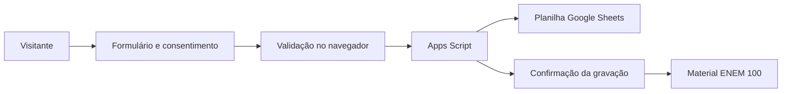

# Aulão ENEM 100 — Landing page de captação

Landing page responsiva de divulgação do **Aulão ENEM 100**, com apresentação de professores e educadores brasileiros, formulário de inscrição e entrega de material educacional.

> Desenvolvido com apoio do **ChatGPT** como ferramenta de inteligência artificial para planejamento, escrita, revisão e programação. Esta referência **não representa parceria, patrocínio, endosso ou afiliação institucional da OpenAI**. A marca Uniube aparece na página como apoiadora do evento conforme os materiais fornecidos para o projeto.

## Funcionalidades

- Apresentação dos educadores, áreas de atuação e propostas didáticas.
- Layout responsivo para desktop e dispositivos móveis.
- Formulário com nome, e-mail e WhatsApp, validações e consentimento explícito.
- Máscara de telefone brasileiro e prevenção básica de submissões automatizadas (honeypot).
- Identificação de origem via UTM, gclid e fbclid.
- Envio de leads para Google Apps Script/Google Sheets por POST de formulário em iframe.
- Confirmação de registro com ID de requisição antes de liberar a visualização/download do material.
- Página de material e seção de política de privacidade integradas por navegação local.
- Conteúdo e fotografias dos educadores, com recursos extraídos do HTML original.

## Estrutura

```text
enem100/
├── index.html                 # estrutura semântica do site
├── css/styles.css             # estilos e media queries
├── js/app.js                  # validação, captura, navegação e download
├── js/config.example.js       # exemplo para configurar a implantação
├── assets/
│   ├── professores/          # fotografias utilizadas na landing page
│   └── materiais/            # PDF utilizado na etapa de entrega
├── docs/INTEGRACAO.md        # implantação e notas de segurança
├── .gitignore
└── README.md
```

## Executar localmente

1. Faça clone/download do repositório.
2. Copie `js/config.example.js` para `js/config.js` e configure a URL `/exec` do aplicativo da Web do Google Apps Script.
3. Sirva a pasta em um servidor HTTP local, por exemplo `python -m http.server 8000`, e abra `http://localhost:8000`.
4. Para executar sem integração, mantenha `leadEndpoint` vazio: o formulário exibirá uma mensagem de configuração pendente.

**O Apps Script e sua planilha não são publicados neste repositório.** A URL de implantação não é uma credencial segura: um navegador sempre consegue visualizá-la quando o formulário funciona. Nunca coloque tokens, senhas ou chaves privadas no front-end. Para proteção contra abuso em produção, considere um backend autenticado e rate limiting; consentimento e controles de privacidade são obrigatórios.

## Fluxo



## Projeto educacional e créditos

A proposta reúne professores e criadores de conteúdo educacional brasileiros em uma página dedicada à preparação para o ENEM. As respectivas identidades, retratos e projetos pertencem a seus titulares e são exibidos no contexto da divulgação do evento. **A presença de nomes, fotos e logotipos não constitui por si só comprovação de parceria ou autorização de redistribuição:** confirme as permissões de publicação dos ativos antes de tornar o repositório público.

Implementação e organização técnica: **Felipe Mendes**. Apoio de desenvolvimento: **ChatGPT** (ferramenta de IA).

## Status

Código preparado para publicação. Integração de leads deve ser configurada individualmente em ambiente de implantação. O repositório não inclui cadastros ou dados pessoais.
